# Chapter 3: Methodology — Flowchart Documentation
## Module: Multi-Pass Theory Scheduling & Final Timetable Assembly (Diagram 3)

This document accompanies the technical flowchart for **Diagram 3** in **Chapter 3 (Methodology)** of the academic project report titled *"Academic Timetable Generator for RIT"*. It specifies the multi-pass relaxation heuristics and final response assembly in [`MasterTimetableGenerator.java`](file:///d:/Programing/Smart%20Timetable%20Management%20System/smart-timetable-backend/src/main/java/in/sd/smarttimetablebackend/service/MasterTimetableGenerator.java) (lines 415–622).

---

### 1. Source Code Verification & Algorithmic Mapping

The flowchart maps directly to the three-tier relaxation engine and finalization logic in `MasterTimetableGenerator.java`:

| Flowchart Node | Java Source Lines | Implemented Constraints & Relaxations |
| :--- | :--- | :--- |
| **Pass 1: Strict Ideal Mode** | Lines 449–496 | • Staggered starting days across the 5-day week (`(sIdx + periodIndex * 2) % days.size()`). • Condition A: Subject-day dispersion (`!hasSubjectOnDay`). • Condition B: Max 1 theory period per teacher per day in that class (`countTheoryPeriodsForFacultyOnDayInClass == 0`). • Condition C: Global faculty daily cap across the college (`currentDaily < maxDailyCap`). • Condition D: Strictly no consecutive periods for the same teacher (`!isAdjacentSlotSameTeacher`). • Resource verification: Class period, faculty, and room available (`isSlotAvailable`). |
| **Decision 1** | Line 458 | Evaluates whether `scheduled >= weeklyPeriods` for all subjects. If all are scheduled, skips directly to final timetable assembly. |
| **Pass 2: Balanced Relaxation** | Lines 498–537 | • Evaluates unplaced backlog: `needed = weeklyPeriods - scheduled`. • **Relaxation:** Relaxes per-class teacher daily limit from 0 to allowing 1 existing period (allowing up to 2 periods total, never 3: `< 2`). • **Retained:** Still enforces subject-day dispersion, global daily cap, hard availability checks, and strictly zero consecutive periods. |
| **Decision 2** | Line 506 | Evaluates whether any unplaced periods remain after Pass 2. If satisfied, transitions directly to final timetable assembly. |
| **Pass 3: Safety Fallback** | Lines 539–556 | • Triggered if periods remain unplaced after Pass 2. • **Relaxations:** Drops subject-day dispersion (permits placing on the same day), drops per-class teacher limits, and drops global daily workload cap. • **Strictly Retained Hard Constraints:** Strictly retains the no-consecutive-periods rule (`!isAdjacentSlotSameTeacher`) and hard resource availability (`isSlotAvailable`). |
| **Decision 3 & Diagnostics** | Lines 559–576 | • Evaluates `if (!placed)`. • Calls `findVacantPeriodsForYear(...)` to inspect remaining open slots. • Identifies conflicting teachers and classrooms, logging detailed explanations to `response.getConflictLog()`. • Appends a `DiagnosticItem("BOTTLENECK", "ERROR", ...)` to `diagnostics`. |
| **Assemble Final Timetable** | Lines 579–604 | • Flattens schedule grid for each cohort (`"SY"`, `"TY"`, `"BTECH"`). • Fills any remaining unassigned slots with empty placeholders: `new MasterCellEntry(day, p, time, yr, "—", "", "", "FREE")`. • Computes total weekly contact hours. |
| **Finalize & Return Response** | Lines 606–622 | • Checks `if (response.getConflictLog().isEmpty())`, adding a `SUCCESS` diagnostic if clean. • Sets `response.setStatus(TimetableStatus.FINALIZED)` (note: marked `FINALIZED` even if unplaced periods exist). • Returns complete `MasterTimetableResponse` to caller. |

---

### 2. High-Level Flowchart (Mermaid Source)

```mermaid
flowchart TD
    Start([Start: Theory Scheduling & Finalization]) --> P1[Pass 1 — Strict Ideal Scheduling:<br/>• Max 1 period/subject/day & max 1 theory/teacher/day in class<br/>• Enforce global daily teacher cap & strictly no consecutive periods<br/>• Hard classroom, faculty, and slot availability verification]

    P1 --> D1{Are All Theory Periods<br/>Assigned in Pass 1?}

    D1 -- No --> P2[Pass 2 — Balanced Relaxation Scheduling:<br/>• Relax per-class teacher limit to max 2 theory periods/day<br/>• Preserve separate days for subjects & global daily teacher cap<br/>• Strictly enforce zero consecutive periods & verify availability]

    D1 -- Yes --> Merge[Assemble Final Timetable]

    P2 --> D2{Are All Theory Periods<br/>Assigned in Pass 2?}

    D2 -- No --> P3[Pass 3 — Fallback Scheduling:<br/>• Relax subject-day dispersion, class limit & daily cap<br/>• Strictly retain no-consecutive-periods rule<br/>• Hard classroom, faculty, and slot availability verification]

    D2 -- Yes --> Merge

    P3 --> D3{Any Theory Periods<br/>Still Unassigned?}

    D3 -- Yes --> Diag[Record Bottleneck Errors & Diagnostics:<br/>• Scan vacant periods and identify conflicting teachers/rooms<br/>• Log error to conflictLog and append BOTTLENECK to diagnostics]

    D3 -- No --> Merge

    Diag --> Merge

    Merge[Assemble Final Timetable:<br/>• Flatten schedules across all cohorts SY, TY, BTech<br/>• Fill remaining empty periods with 'FREE' &lt;—&gt;<br/>• Calculate total weekly contact hours per cohort] --> Finalize[Finalize & Return Response:<br/>• Append SUCCESS diagnostic if conflict log is empty<br/>• Set response status = FINALIZED &lt;even if unplaced periods exist&gt;<br/>• Return complete MasterTimetableResponse object]

    Finalize --> EndNode([End])
```

---

### 3. Report Deliverable Files

The deliverable files are saved in [`report-diagrams/`](file:///d:/Programing/Smart%20Timetable%20Management%20System/report-diagrams):
* **Vector Diagram:** [`diagram3_theory_scheduling.svg`](file:///d:/Programing/Smart%20Timetable%20Management%20System/report-diagrams/diagram3_theory_scheduling.svg) (Standalone high-quality SVG formatted for Microsoft Word).
* **Mermaid Source:** [`diagram3_theory_scheduling.mmd`](file:///d:/Programing/Smart%20Timetable%20Management%20System/report-diagrams/diagram3_theory_scheduling.mmd) (Editable raw text file).
* **Documentation:** [`diagram3_theory_scheduling_methodology_doc.md`](file:///d:/Programing/Smart%20Timetable%20Management%20System/report-diagrams/diagram3_theory_scheduling_methodology_doc.md) (Methodological documentation for Chapter 3).
