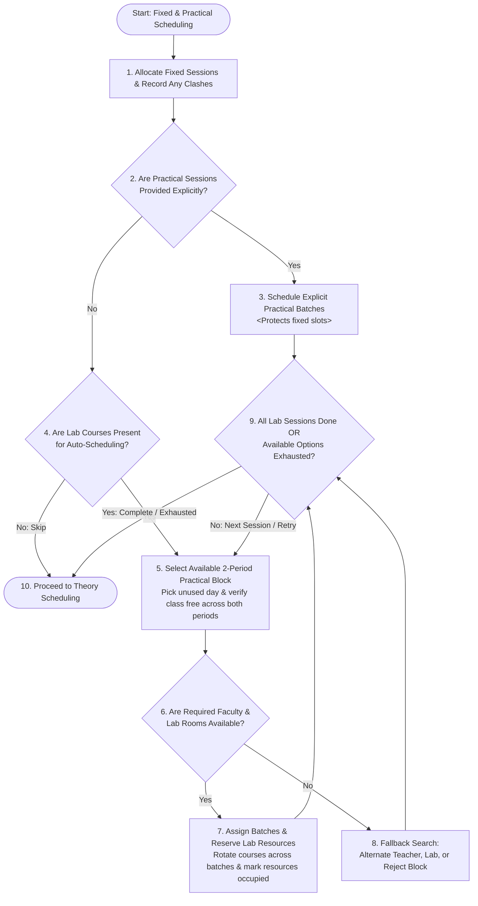

# Chapter 3: Methodology — Flowchart Documentation
## Module: High-Level Fixed-Session Allocation & Practical Scheduling

This document accompanies the simplified technical flowchart for **Chapter 3 (Methodology)** of the academic project report titled *"Academic Timetable Generator for RIT"*. It presents the streamlined, high-level operational pipeline for **Stage 3 (Mandatory Fixed-Session Allocation)** and **Stage 4 (Practical Lab Scheduling)** as implemented in [`MasterTimetableGenerator.java`](file:///d:/Programing/Smart%20Timetable%20Management%20System/smart-timetable-backend/src/main/java/in/sd/smarttimetablebackend/service/MasterTimetableGenerator.java).

---

### 1. High-Level Algorithmic Steps

The simplified flowchart consolidates internal implementation details into **10 core sequential phases** (9 main functional blocks + Start/End), ideal for second-year project report figures and presentation slides:

```
[Start: Fixed & Practical Scheduling]
       │
       ▼
1. Allocate Fixed Sessions & Record Any Clashes
       │
       ▼
2. [Decision] Are Practical Sessions Provided Explicitly?
       ├─────► (Yes) ──► 3. Schedule Explicit Practical Batches ───┐
       ▼ (No)                                                      │
4. [Decision] Are Lab Courses Present for Auto-Scheduling?          │
       ├─────► (No) ──► Skip to Stage 5                            │
       ▼ (Yes)                                                     │
5. Select Available 2-Period Practical Block on Open Day           │
       │                                                           │
       ▼                                                           │
6. [Decision] Are Required Faculty & Lab Rooms Available?          │
       ├─────► (No)  ──► 8. Fallback Search (Alt Teacher/Lab/Block)─┤
       ▼ (Yes)                                                     │
7. Assign Batches & Reserve Lab Resources                          │
       │                                                           │
       ▼                                                           │
9. [Decision] All Sessions Done OR Available Options Exhausted? ◄──┘
       ├─────► (No: Next Session / Retry Block) ──► Loop to Step 5
       ▼ (Yes: Complete / Exhausted)
10. Proceed to Theory Scheduling (Stage 5)
```

---

### 2. Detailed Explanation of the 10 Steps

| Step | Node Type | Source Code Reference | Operational Behavior |
| :---: | :--- | :--- | :--- |
| **Start** | Terminal (Oval) | Line 177 | Invoked from `MasterTimetableGenerator.generate(request)` after Stage 1 (Faculty Unavailability) and Stage 2 (FY External Loads). |
| **1** | Process (Rectangle) | Lines 178–250 | **Allocate Fixed Sessions & Record Any Clashes:** Schedules non-negotiable institutional slots (MDM, Open Electives, Mentoring, Capstone). In accordance with institutional requirements, collisions (with previous fixed slots, teachers, or classrooms) are recorded in `diagnostics` as errors/warnings, but the fixed slot is booked regardless of overlap. |
| **2** | Decision (Diamond) | Lines 270–272 | **Are Practical Sessions Provided Explicitly?** Evaluates `hasExplicitPracticals` (`yData.getPracticals()` with specified days and periods). |
| **3** | Process (Rectangle) | Lines 273–408 | **Schedule Explicit Practical Batches:** Groups user-provided assignments into parallel batches (`I1`–`I4`). Preserves locked fixed slots (rejecting clashing practicals), resolves teacher double-booking with alternate candidate pools, and assigns available computer laboratories (`IL1`–`IL6`). |
| **4** | Decision (Diamond) | Line 409 | **Are Lab Courses Present for Auto-Scheduling?** Verifies whether `yData.getLabCourses()` contains courses requiring automated assignment. If none, practical scheduling is bypassed for this cohort. |
| **5** | Process (Rectangle) | Lines 864–890 | **Select Available 2-Period Practical Block on Open Day:** Identifies an unused day in the week (enforcing a strict limit of 1 practical session per day per cohort) and tests candidate 2-hour continuous blocks (`P1-P2`, `P3-P4`, `P5-P6`) where the class schedule is completely open across both periods. |
| **6** | Decision (Diamond) | Lines 891–977 | **Are Required Faculty & Lab Rooms Available?** Checks whether assigned faculty members and preferred computer labs are simultaneously available across both periods for all 4 parallel batches without global or intra-cell double-booking. |
| **7** | Process (Rectangle) | Lines 897–902 & 979–1025 | **Assign Batches & Reserve Lab Resources:** Rotates lab courses across batches via a Latin Square rotation formula ($sIdx = (bIdx + cIdx) \pmod{numCourses}$). Creates a linked 2-period `MasterCellEntry` containing 4 batch sub-entries, reserves teachers and computer labs, and updates workload counters. |
| **8** | Process (Rectangle) | Lines 914–945 & 955–974 | **Fallback Search:** If a conflict occurs, searches for an available alternate teacher from the course's faculty pool or the department faculty list, and searches for an alternative free lab from `availableLabRooms` (`IL1`–`IL6`). If resources remain unresolvable, rejects the 2-hour block (`blockAvailable = false`) to attempt the next block or day. |
| **9** | Decision (Diamond) | Lines 873 & 1026–1028 | **All Lab Sessions Done OR Available Options Exhausted?** Checks if all required laboratory courses ($numCourses$) have been scheduled for the cohort, or if all valid continuous blocks and days have been exhausted. If more sessions remain, loops back to Step 5; otherwise, transitions forward. |
| **10** | Terminal (Oval) | Line 416 | **Proceed to Theory Scheduling:** Hands over the resulting schedule grid, marked room bookings, and updated faculty workloads to Stage 5 for multi-pass theory lecture scheduling. |

---

### 3. Key Methodological Insights for Second-Year Project Report

1. **Detection vs. Rejection:**
   * **Stage 3 Institutional Bookings:** Conflicts are logged as informational warnings or errors, but assignments are preserved because institutional slots cannot be moved automatically.
   * **Stage 4 Automated Practicals:** Conflicts strictly reject candidate 2-hour blocks and trigger multi-level resource fallbacks to ensure zero collisions in the generated schedule.
2. **Realistic Completion (No Guarantee of 100% Fit):**
   * The flowchart does not unrealistically assume all sessions are guaranteed to fit; if classroom blocks or teacher pools are exhausted, the loop terminates gracefully through Decision 9 and passes the schedule to subsequent stages.
3. **No Visual Overlap:**
   * Decision branches follow clean vertical trunks and non-intersecting lateral loops designed to fit comfortably on a single portrait A4 page in Microsoft Word.

---

### 4. Editable Mermaid Diagram Source


